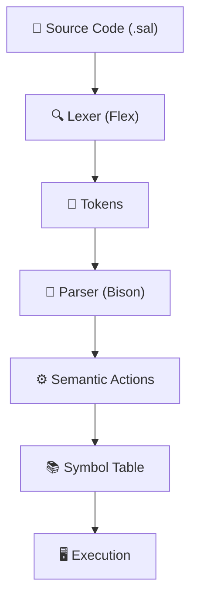

# 🚀 SuperAnandLang

### A tiny programming language with a big ambition.

<p align="center">
  
  
  
  
  
</p>

<p align="center">
  <b>SuperAnandLang</b> is an experimental programming language built from scratch using C, Flex, and Bison.
  <br>
  Designed as a hands-on exploration of lexical analysis, grammar design, parsing, and language implementation.
</p>

---

## 🌟 What is SuperAnandLang?

SuperAnandLang is a personal programming language project created to explore what happens behind the scenes when a programming language is interpreted.

Instead of relying on an existing language framework, this project builds its own:

- 🔍 Lexer to recognize tokens.
- 🌳 Parser to validate syntax.
- ⚙️ Semantic actions to evaluate operations.
- 📚 Symbol table to manage variables.
- 🧠 Grammar rules to define the language.

The goal isn't just to make another programming language. It's to understand how one actually works.

---

## ✨ Features

| Feature | Description |
|---|---|
| 🖨️ Output | `whatis` statement |
| 📦 Variables | Integer declarations using `believe` |
| ➕ Arithmetic | Addition, subtraction, multiplication, division |
| 🧮 Precedence | Parentheses and arithmetic precedence |
| 🔄 Assignment | Normal and compound assignments |
| ⬆️ Increment | Postfix `++` and `--` |
| 🔤 Strings | String literals and concatenation |
| 💬 Comments | Single-line and multiline comments |
| 🚪 Exit | `exit()` statement |
| 🛡️ Errors | Basic syntax and runtime error handling |

### 📝 A Little Look at the Syntax

```sal
$$ Variable declarations
believe age = 19;
believe score = 100;

$$ Arithmetic
believe result = (score + 50) * 2;

$$ Compound assignment
score += 25;
age++;

$$ Output
whatis "Welcome to SuperAnandLang!";
whatis "Age: " + age;
whatis "Score: " + score;
whatis "Result: " + result;

exit();
```

---

## 🏗️ How It Works

SuperAnandLang uses Flex for lexical analysis and Bison for syntax analysis.



### 🔍 The Components

| Component | Responsibility |
|---|---|
| `lexical.l` | Recognizes keywords, identifiers, operators, and literals |
| `parser.y` | Defines grammar and parsing rules |
| Symbol Table | Stores variable names and values |
| Semantic Actions | Performs calculations and executes statements |
| `Makefile` | Automates compilation and execution |

---

## 🛠️ Built With

<p>
  
</p>

- **C** — Core implementation.
- **Flex** — Lexical analyzer generation.
- **Bison** — Parser generation.
- **Make** — Build automation.
- **TextMate Grammar** — Syntax highlighting for VS Code.

---

## ⚡ Getting Started

### 📋 Requirements

- GCC
- Flex
- Bison
- Make

### 1️⃣ Clone the Repository

```bash
git clone https://github.com/SuperAnand67/SuperAnandLang.git
cd SuperAnandLang
```

### 2️⃣ Build the Project

```bash
make
```

### 3️⃣ Run the Language

```bash
make run
```

### 4️⃣ Run a Specific File

```bash
make run TEST_FILE=example.sal
```

### 🧹 Clean Generated Files

```bash
make clean
```

---

## 🎨 VS Code Support

SuperAnandLang includes a custom VS Code language extension for `.sal` files.

Current editor features:

- 🎨 Syntax highlighting.
- 💬 Comment configuration.
- 🔗 Bracket configuration.
- 📦 VSIX packaging support.

---

## 📁 Project Structure

```text
SuperAnandLang/
│
├── lexical.l
├── parser.y
├── Makefile
├── test.sal
├── README.md
├── LICENSE
│
└── vscode-extension/
    ├── package.json
    ├── syntaxes/
    └── language-configuration.json
```

---

## 🚧 Current Limitations

This project is still under active development.

Some features that are not yet implemented or fully developed:

- 🔤 String variables.
- 🔀 General mixed string and arithmetic concatenation.
- 🤔 Conditional statements.
- 🔁 Loops.
- 🧩 Functions.
- 📦 Arrays and data structures.
- 🔢 Floating-point and Boolean types.
- 🌳 Abstract Syntax Tree (AST).
- ⚙️ Intermediate Representation (IR).
- 💻 Native machine-code generation.

---

## 🗺️ Roadmap

- [x] Build a lexer using Flex.
- [x] Build a parser using Bison.
- [x] Implement integer variables.
- [x] Implement arithmetic expressions.
- [x] Implement a symbol table.
- [x] Implement compound assignment operators.
- [x] Implement increment and decrement.
- [x] Implement string literals.
- [x] Add basic string concatenation.
- [x] Add a custom VS Code syntax-highlighting extension.
- [ ] Improve mixed string and arithmetic concatenation.
- [ ] Strengthen memory management.
- [ ] Add comprehensive automated tests.
- [ ] Implement an Abstract Syntax Tree.
- [ ] Separate parsing and execution.
- [ ] Explore intermediate representation and code generation.

---

## 🎯 Learning Goals

This project explores several fundamental computer science concepts:

- Compiler construction.
- Context-free grammars.
- Recursive grammar rules.
- Parsing and ambiguity.
- Lexical analysis.
- Semantic analysis.
- Symbol tables.
- Dynamic memory management in C.
- Language design and syntax engineering.

---

## 👨‍💻 Author

**SuperAnand67**

🔗 GitHub: [SuperAnand67](https://github.com/SuperAnand67)

---

## 📜 License

Distributed under the MIT License. See [LICENSE](LICENSE) for more information.

---

<p align="center">
  ⭐ If you find this project interesting, consider giving it a star!
  <br><br>
  <b>Built from curiosity, one grammar rule at a time. 🚀</b>
</p>
